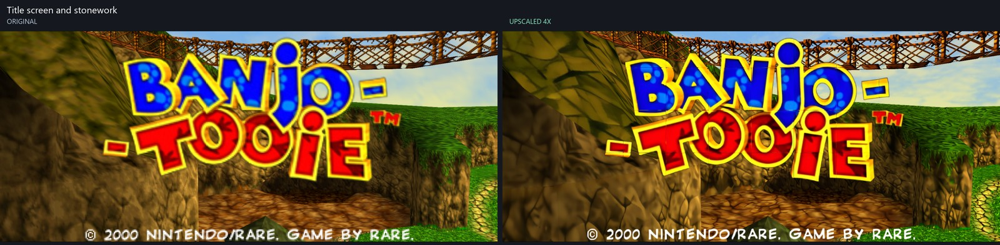
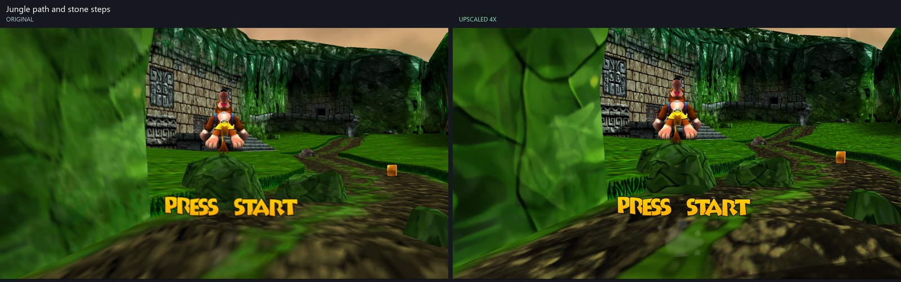
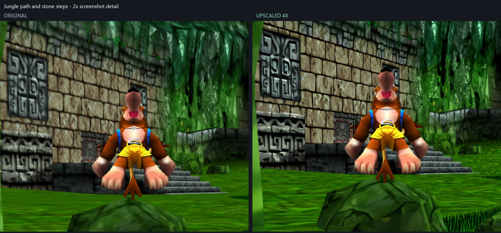
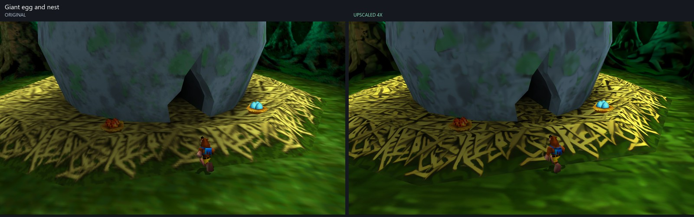
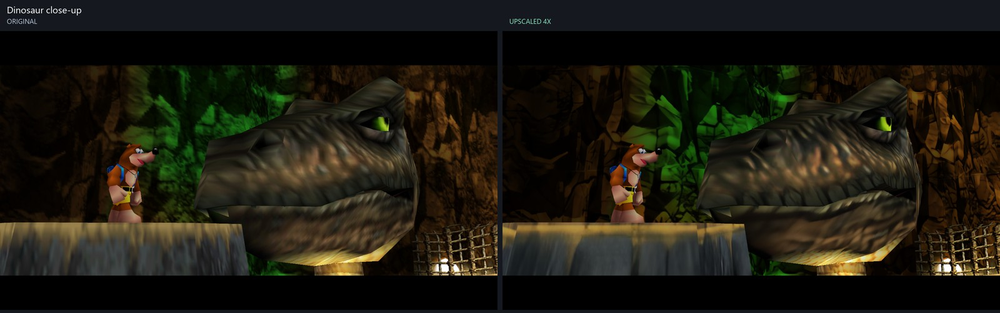
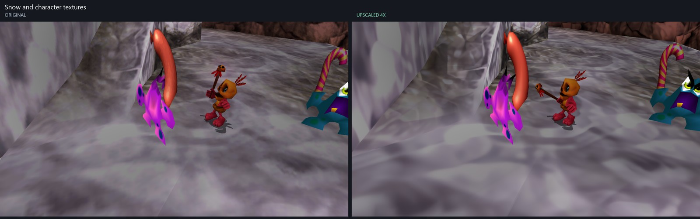
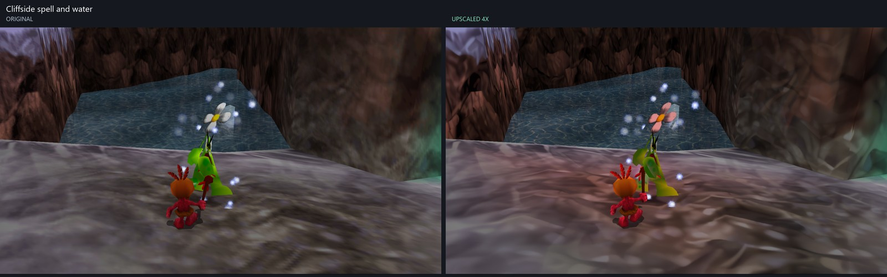
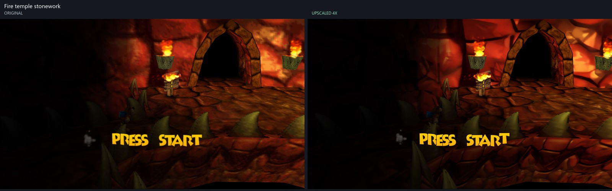
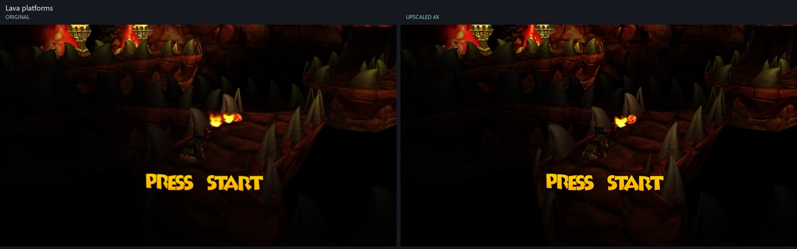

# Banjo-Tooie Upscaled Textures 4x

An unofficial 4x texture pack for Banjo-Tooie Recompiled, with a saved **Original / Upscaled 4x** setting.

**[Download v1.0.0](https://github.com/vending-machine-git/BanjoTooie-Upscaled-Textures/releases/tag/v1.0.0)** - Windows package, approximately 589 MB.

## Compatibility - read before downloading

You need an existing Banjo-Tooie Recompiled installation, your own supported USA ROM, and a runtime with RT64 texture-pack registration.

**Stock Windows x64 v1.0.1 does not register texture-pack support.** Its Mods menu alone is insufficient: copying this pack into that version will not make it appear. This pack was tested with our local **1.0.1+textures** build. The download includes the compatibility source and build instructions. It does **not** include a prebuilt runtime or an executable-patching installer. Other runtime versions have not been tested.

Players with a compatible runtime do not need Python, chaiNNer, AI models, or a compiler to load the texture pack.

## Install on a compatible runtime

1. Download and extract `BanjoTooie-Upscaled-4x-1.0.0.zip` from Releases.
2. Keep `BanjoTooie-Upscaled-4x.rtz` intact and copy it to:
   ```text
   %LOCALAPPDATA%\BanjoTooieRecompiled\mods\
   ```
   Create the `mods` folder if needed.
3. Start the game and enable **Banjo-Tooie Upscaled Textures 4x** in **Mods**.
4. Open **Configure > Texture quality** and choose **Original** or **Upscaled 4x**.

The setting can change while playing and is saved. The main mod enable switch also turns the pack off or on.

To remove the pack, close the game and remove its `.rtz` file from the mods folder. Keep your existing ROM and saves.

## Texture comparisons

**Original is on the left; Upscaled 4x is on the right.** Click an image to open the full-resolution PNG.

These are actual 1600 x 900 game captures from the title sequence and automatic gameplay demos, with identical graphics settings. Selected pairs are matched within one guest frame; small animation, lighting, and camera timing differences can remain. Detail images use nearest-neighbor enlargement without sharpening or color correction.

The upscaled title logo has visible tile seams, which are preserved in the comparison below.

### Title screen and stonework

[](assets/screenshots/01-title-and-stonework.png)

### Jungle path and stone steps

[](assets/screenshots/02-jungle-stone-steps.png)

Enlarged stonework detail:

[](assets/screenshots/02-jungle-stone-steps-detail.png)

### Giant egg and nest

[](assets/screenshots/03-giant-egg-and-nest.png)

### Dinosaur close-up

[](assets/screenshots/04-dinosaur-close-up.png)

### Snow and character textures

[](assets/screenshots/05-snow-and-character-textures.png)

### Cliffside spell and water

[](assets/screenshots/06-cliffside-spell.png)

### Fire temple stonework

[](assets/screenshots/07-fire-temple-stonework.png)

### Lava platforms

[](assets/screenshots/08-lava-platforms.png)

## Coverage and validation

- 11,033 extracted textures upscaled to 4x resolution.
- 15,119 RT64 hash mappings, including animation windows, font widths, and mipmaps.
- Unmapped textures use their original rendering.
- The comparison capture runs recorded zero texture replacements in Original mode and 747 distinct replacements at 4x scale in Upscaled mode. Earlier validation also matched the font and mip mappings observed in the attract sequence.
- This is not a full-playthrough verification; compatibility with other mods is not established.

## Download contents

The release ZIP contains the texture pack, installation guide, checksums, compatibility source archive, and source patch. It excludes the ROM, saves, personal settings, full game executable, runtime dependencies, and development logs.

The ZIP is a GitHub Release asset rather than a file in Git history. Verify it using the accompanying `.sha256` file. `package-verification.json` records archive integrity and payload hashes.

## Runtime compatibility source

The release's `source/texture-support-source.zip` contains the parent repository at local commit `2d40c52`. Fetch its pinned dependency submodules separately and follow its README and `tools/setup_deps.py` instructions to apply the dependency patches before building.

`source/texture-support.patch` records the changes against upstream commit `9e5852541ba1436417e2c4468960e8c6de6deda5` of [Vidanox/BanjoTooieRecompiled](https://github.com/Vidanox/BanjoTooieRecompiled). The source archive includes `COPYING` and dependency pins/patches.

## Credits and rights

Texture pack assembled by Reyes. Original artwork originates from Banjo-Tooie. Upscaling does not transfer ownership of that artwork. This project is unofficial and is not affiliated with Nintendo, Rare, or Microsoft. Included runtime source retains its existing license notices; this repository does not grant a new license to the original game artwork.
